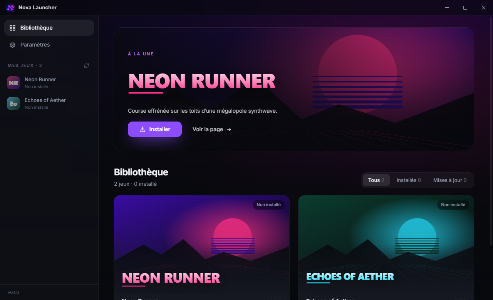
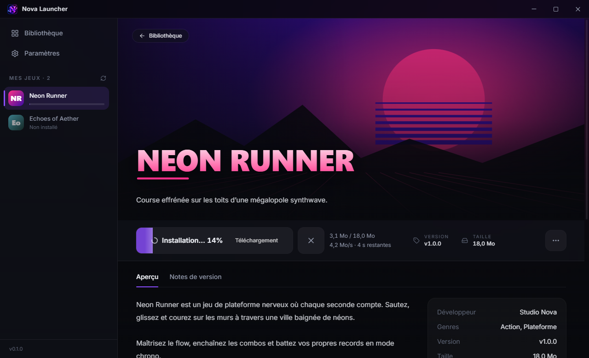
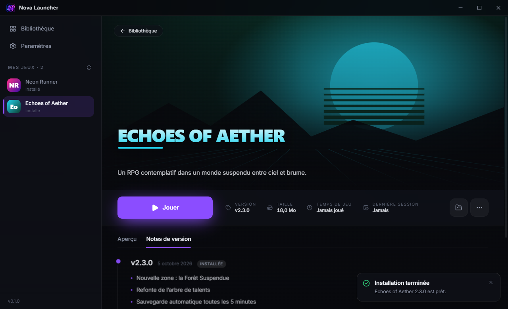

# Nova Launcher

Launcher desktop pour installer, mettre à jour et lancer **vos** jeux — inspiré de Steam, Epic Games et Riot Client.
Electron + React + Vite + TypeScript, Tailwind CSS, Zustand, electron-store, electron-builder / electron-updater.



| Installation (progression, vitesse, annulation) | Page d'un jeu (notes de version) |
| --- | --- |
|  |  |

## Sommaire

- [Démarrage rapide](#démarrage-rapide)
- [Connecter vos jeux (pas à pas)](#connecter-vos-jeux-pas-à-pas)
- [Structure du projet](#structure-du-projet)
- [Personnaliser l'identité (nom, couleurs, logo)](#personnaliser-lidentité)
- [Le manifeste `games.json`](#le-manifeste-gamesjson)
- [Ajouter un nouveau jeu au manifeste](#ajouter-un-nouveau-jeu-au-manifeste)
- [Publier une release d'un jeu](#publier-une-release-dun-jeu)
- [Builder le launcher](#builder-le-launcher)
- [Publier une mise à jour du launcher (auto-update)](#publier-une-mise-à-jour-du-launcher)
- [Fonctionnement interne](#fonctionnement-interne)
- [Tests](#tests)

---

## Démarrage rapide

Prérequis : Node.js 20+ (testé avec Node 24), Windows 10/11 (macOS / Linux possibles, voir plus bas).

```bash
npm install
npm run make:test-games   # compile 2 vrais jeux de démo (.exe) + zips + games.example.json
npm run dev               # lance le launcher en mode développement (hot reload)
```

En développement, le launcher lit `games.example.json` à la racine du projet. Pour tester une **mise à jour**,
allez dans *Paramètres → URL du manifeste* et choisissez `games.example.v2.json` (Neon Runner passe de 1.0.0 à 1.1.0).

Pour tester un vrai téléchargement HTTP (débit bridé à 8 Mo/s, reprise supportée) :

```bash
npm run serve:test
```

puis mettez `http://127.0.0.1:8787/games.example.json` comme URL du manifeste.

| Commande | Rôle |
| --- | --- |
| `npm run dev` | Lancement en développement |
| `npm run typecheck` | Vérification TypeScript (main + renderer) |
| `npm run build` | Typecheck + build de production dans `out/` |
| `npm run e2e` | Test de bout en bout (Playwright pilote la vraie app) |
| `npm run dist` | Installeur Windows NSIS dans `release/<version>/` |
| `npm run release` | Build + publication sur GitHub Releases (auto-update) |
| `npm run make:test-games` | Régénère les jeux de démo et les manifestes d'exemple |
| `npm run make:icon` | Génère toutes les icônes depuis `assets-src/icon-source.*` |
| `npm run package-game` | Zippe un build de jeu, calcule le SHA-256 et met à jour `games.json` |

## Connecter vos jeux (pas à pas)

Configuration recommandée : **un dépôt GitHub public** (ex. `mon-compte/nova-games`) qui contient
`games.json` + les images, et dont les **Releases** hébergent les zips des jeux. Gratuit, rapide, et la reprise
de téléchargement fonctionne.

### 1. Une seule fois : créer le dépôt du catalogue

```
nova-games/
  games.json
  assets/
    mon-jeu-icon.png      256×256
    mon-jeu-logo.png      PNG transparent, large
    mon-jeu-banner.jpg    1920×1080
    mon-jeu-shot1.jpg     captures d'écran
```

Dans `games.json`, les chemins d'images peuvent rester **relatifs** (`"banner": "assets/mon-jeu-banner.jpg"`) :
ils sont résolus par rapport à l'URL du manifeste.

### 2. Une seule fois : pointer le launcher sur ce catalogue

Dans `src/shared/branding.ts` :

```ts
defaultManifestUrl: 'https://raw.githubusercontent.com/mon-compte/nova-games/main/games.json',
```

(Chaque joueur peut aussi la changer dans *Paramètres → URL du manifeste*.)

### 3. À chaque version d'un jeu

Exportez le build de votre jeu (Unity, Godot, Unreal…) dans un dossier, puis :

```bash
npm run package-game -- "C:/Builds/MonJeu" --id mon-jeu --name "Mon Jeu" --version 1.0.0 --exe MonJeu.exe --github mon-compte/nova-games --notes "Sortie initiale;Support manette" --manifest ../nova-games/games.json
```

Le script :

- zippe le dossier dans `publish/mon-jeu-1.0.0.zip` ;
- calcule le **SHA-256** et la taille ;
- ajoute ou met à jour l'entrée du jeu dans `games.json` (version, URL, hash, taille, notes de version) ;
- affiche la commande `gh release create …` pour uploader le zip.

Il reste à exécuter cette commande, compléter la première fois la description et les images du jeu dans
`games.json`, puis `git push` le dépôt du catalogue. Les launchers affichent le jeu (ou « Mettre à jour ») au
prochain démarrage, au bouton ⟳ ou dans les 30 minutes.

Pour les versions suivantes, `--name` et `--exe` sont facultatifs : seule la version change.

> Pas de GitHub ? Remplacez `--github …` par `--base-url https://mon-site.com/jeux/` et uploadez le zip à cet
> endroit (S3, Cloudflare R2, FTP…).

### 4. Changer l'icône du launcher

Placez votre image dans `assets-src/icon-source.png` (png/jpg/webp, fond blanc accepté), puis :

```bash
npm run make:icon
```

Le fond blanc est retiré automatiquement ; l'icône de l'exe, de l'installeur, de la fenêtre et le logo de la
barre de titre sont régénérés.

## Structure du projet

```
src/
  main/                 Processus principal (Node)
    index.ts            Fenêtre sans bordure, instance unique, cycle de vie
    ipc.ts              Handlers IPC (bibliothèque, jeux, paramètres, fenêtre, updater)
    library.ts          Orchestrateur : manifeste, jobs d'installation, jeux lancés
    manifest.ts         Lecture/validation de games.json (http, https, file, URLs relatives)
    github.ts           Source GitHub Releases (un dépôt = un jeu)
    downloader.ts       Téléchargement streaming + reprise (HTTP Range) + annulation
    installer.ts        SHA-256 → extraction en staging → remplacement atomique
    runner.ts           Lancement (child_process) et suivi des jeux en cours
    updater.ts          Auto-update du launcher (electron-updater)
    store.ts            Persistance (electron-store) : paramètres + jeux installés
    assets.ts           Protocole nova-asset:// pour les images locales
  preload/index.ts      API sécurisée window.api (contextBridge, sandbox)
  renderer/             UI React
    src/theme.css       ★ Thème centralisé (couleurs, accent, typo)
    src/components/     TitleBar, Sidebar, GameCard, ActionButton, Backdrop…
    src/views/          Bibliothèque, Page jeu, Paramètres
    src/store/          Store Zustand
  shared/               Types et contrat IPC partagés
    types.ts            Game, Manifest, InstallProgress, Settings…
    branding.ts         ★ Nom du launcher, URL du manifeste par défaut
scripts/                Jeux de test, serveur de test, e2e, icône
test-games/             Source C# du jeu de démo + visuels SVG
games.example.json      Manifeste d'exemple (2 jeux fictifs)
electron-builder.yml    Configuration de l'installeur et de l'auto-update
```

## Personnaliser l'identité

| Quoi | Où |
| --- | --- |
| Couleurs, accent, typo, arrondis | `src/renderer/src/theme.css` (chaque `--color-*` devient une classe Tailwind : `bg-accent`, `text-muted`…) |
| Nom affiché, URL du manifeste par défaut, fréquence de vérification | `src/shared/branding.ts` |
| Nom de l'exécutable et du dossier `%APPDATA%` | `productName` dans `package.json` **et** `electron-builder.yml` |
| Logo, icône de l'app et de l'installeur | `assets-src/icon-source.*` puis `npm run make:icon` |
| Titre de la fenêtre | `<title>` dans `src/renderer/index.html` |

Chaque jeu peut aussi définir son propre `accentColor` dans le manifeste : sa page prend alors cette couleur.

Sans visuels, le launcher génère des **placeholders** propres (dégradé + initiales) à partir de l'id du jeu.

## Le manifeste `games.json`

Le launcher lit un fichier JSON hébergé où vous voulez (GitHub raw, S3, votre site…) — URL configurable dans
*Paramètres*. Les URL d'images et de téléchargement peuvent être **absolues ou relatives** à l'URL du manifeste.

```jsonc
{
  "games": [
    {
      "id": "neon-runner",                   // unique ; lettres, chiffres, - et _ (sert de nom de dossier)
      "name": "Neon Runner",
      "tagline": "Course effrénée sur les toits…",
      "description": "Texte long.\n\nLes sauts de ligne sont conservés.",
      "developer": "Studio Nova",
      "genres": ["Action", "Plateforme"],
      "icon": "assets/neon-runner-icon.png",     // carré, ~256×256
      "logo": "assets/neon-runner-logo.png",     // PNG transparent, large
      "banner": "assets/neon-runner-banner.jpg", // 1920×1080
      "screenshots": ["assets/shot1.jpg", "assets/shot2.jpg"],
      "accentColor": "#ff2e88",                  // optionnel
      "version": "1.1.0",                        // semver
      "downloadUrl": "https://cdn.exemple.com/neon-runner-1.1.0.zip",
      "sha256": "4f1c…",                         // hash du zip (recommandé)
      "size": 25165824,                          // taille du zip en octets
      "executable": "NeonRunner.exe",            // relatif à la racine du zip
      "executables": { "darwin": "NeonRunner.app/Contents/MacOS/NeonRunner", "linux": "NeonRunner.x86_64" },
      "args": ["--fullscreen"],                  // optionnel
      "changelog": [
        { "version": "1.1.0", "date": "2026-10-12", "notes": ["Nouveau niveau", "Corrections"] },
        { "version": "1.0.0", "date": "2026-09-01", "notes": "Sortie initiale" }
      ]
    }
  ]
}
```

Champs obligatoires : `id`, `name`, `executable`, et soit (`version` + `downloadUrl`), soit `github`.

Si le zip contient un **unique dossier parent** (`MonJeu/MonJeu.exe`), le launcher l'aplatit automatiquement.

## Ajouter un nouveau jeu au manifeste

1. **Préparez le build** de votre jeu dans un dossier (ex. export Unity / Godot / Unreal).
2. **Zippez** le contenu du dossier :
   ```powershell
   Compress-Archive -Path .\MonJeu\* -DestinationPath .\mon-jeu-1.0.0.zip
   ```
3. **Calculez le SHA-256 et la taille** :
   ```powershell
   (Get-FileHash .\mon-jeu-1.0.0.zip -Algorithm SHA256).Hash.ToLower()
   (Get-Item .\mon-jeu-1.0.0.zip).Length
   ```
4. **Hébergez** le zip et les visuels (GitHub Releases, bucket S3/R2, votre serveur…). Le serveur doit
   idéalement supporter les requêtes `Range` (c'est le cas de GitHub, S3, Cloudflare R2, nginx…) pour que la
   reprise de téléchargement fonctionne.
5. **Ajoutez l'entrée** dans `games.json` (voir le format ci-dessus) avec `version`, `downloadUrl`, `sha256`,
   `size` et `executable`.
6. **Publiez** `games.json`. Les launchers le relisent au démarrage, toutes les 30 min, et via le bouton ⟳.

## Publier une release d'un jeu

### Option A — via le manifeste (n'importe quel hébergement)

1. Zippez la nouvelle version (`mon-jeu-1.1.0.zip`), calculez `sha256` et `size` (cf. ci-dessus) et uploadez-la.
2. Dans `games.json`, mettez à jour `version`, `downloadUrl`, `sha256`, `size` et ajoutez une entrée **en tête**
   de `changelog`.
3. Publiez `games.json`. Les joueurs voient « Mettre à jour » (comparaison semver version locale ↔ manifeste).

### Option B — via GitHub Releases (un dépôt = un jeu)

Dans le manifeste, remplacez `version` / `downloadUrl` / `sha256` / `size` par une source `github` :

```json
{
  "id": "mon-jeu",
  "name": "Mon Jeu",
  "description": "…",
  "banner": "https://…/banner.jpg",
  "executable": "MonJeu.exe",
  "github": { "repo": "mon-compte/mon-jeu", "asset": "mon-jeu-*.zip" }
}
```

Puis, pour chaque version :

```bash
gh release create v1.1.0 ./mon-jeu-1.1.0.zip --repo mon-compte/mon-jeu --title "v1.1.0" --notes-file CHANGELOG-1.1.0.md
```

Le launcher lit la **dernière release** : version = tag (`v1.1.0` → `1.1.0`), zip = premier asset correspondant à
`asset` (défaut : premier `.zip`), taille et **SHA-256** fournis par GitHub (champ `digest`), notes de version =
description de la release. Si votre release n'a pas de digest, ajoutez un asset `mon-jeu-1.1.0.zip.sha256`
contenant le hash. `"prerelease": true` inclut les pre-releases.

Pour un dépôt **privé** ou pour éviter la limite de 60 requêtes/h de l'API GitHub, renseignez un jeton
(*Paramètres → Jeton GitHub*, scope lecture seule « Contents »).

## Builder le launcher

```bash
npm run dist
```

Produit dans `release/<version>/` :

- `Nova Launcher-Setup-<version>.exe` — installeur NSIS (choix du dossier, raccourcis bureau + menu Démarrer)
- `latest.yml` + `.blockmap` — métadonnées utilisées par l'auto-update
- `win-unpacked/` — version portable non installée (pratique pour tester)

> **Signature de code** : sans certificat, Windows SmartScreen affiche « Éditeur inconnu » au premier lancement.
> Pour signer, définissez `CSC_LINK` (chemin du `.pfx`) et `CSC_KEY_PASSWORD` avant `npm run dist`.

macOS / Linux : `npx electron-builder --mac` ou `--linux` (à lancer depuis la plateforme cible).
Les jeux peuvent déclarer un exécutable par plateforme via `executables`.

## Publier une mise à jour du launcher

1. Dans `electron-builder.yml`, remplacez `owner: OWNER` / `repo: REPO` par votre dépôt GitHub
   (tant que ce n'est pas fait, l'auto-update est désactivé et l'indique dans les Paramètres).
2. Incrémentez `version` dans `package.json` (ex. `0.1.0` → `0.2.0`).
3. Créez un jeton GitHub avec le droit d'écriture sur les releases, puis :
   ```powershell
   $env:GH_TOKEN = "ghp_…"
   npm run release
   ```
4. Les launchers installés vérifient au démarrage, téléchargent en arrière-plan et proposent
   « Redémarrer pour mettre à jour » dans la barre de titre (ou installent à la fermeture).

Pensez aussi à changer `defaultManifestUrl` dans `src/shared/branding.ts` pour pointer sur votre `games.json`.

## Fonctionnement interne

**Installation / mise à jour** (`src/main/installer.ts`) :

1. Vérification de l'espace disque libre.
2. Téléchargement en streaming vers `<dossier jeux>/.downloads/<id>-<version>.zip.part` avec progression,
   vitesse et temps restant. En cas de coupure réseau, le `.part` est conservé : relancer reprend là où ça
   s'est arrêté (HTTP `Range`). Une annulation volontaire supprime les fichiers partiels.
3. Vérification **SHA-256** ; si elle échoue, le zip est supprimé et une erreur explicite est affichée.
4. Extraction dans `.staging/<id>` (protection contre les chemins `../` malveillants).
5. Remplacement **atomique** : l'ancienne version est déplacée dans `.trash`, la nouvelle prend sa place,
   puis l'ancienne est supprimée. En cas d'échec, l'ancienne version est restaurée — un jeu installé n'est
   jamais laissé à moitié mis à jour. Les restes d'une installation interrompue sont nettoyés au démarrage.

**Dossiers** (Windows) :

- Jeux : `%APPDATA%\Nova Launcher\games\<id>\` (modifiable dans les Paramètres)
- Paramètres et jeux installés : `%APPDATA%\Nova Launcher\launcher.json`

**Sécurité** : `contextIsolation`, `sandbox`, pas de `nodeIntegration`, CSP stricte, navigation et ouverture de
fenêtres bloquées (les liens http(s) s'ouvrent dans le navigateur), suppression limitée au dossier portant l'id
du jeu, accès disque du renderer limité aux dossiers du manifeste via `nova-asset://`.

**Lancement** : le jeu est lancé avec son dossier comme répertoire courant ; le launcher détecte sa fermeture,
comptabilise le temps de jeu et affiche « En cours » pendant la partie. Avec l'option *Fermer le launcher au
lancement*, le jeu est détaché et le launcher se ferme.

## Tests

```bash
npm run make:test-games   # une fois
npm run e2e
```

Le test de bout en bout lance la vraie application avec un profil temporaire et un serveur HTTP local bridé,
puis vérifie : chargement du manifeste (file:// et http://), annulation, **coupure réseau + reprise**, SHA-256,
lancement et détection de fermeture du jeu, mise à jour 1.0.0 → 1.1.0, zip avec dossier parent,
désinstallation avec confirmation, persistance des paramètres, absence d'erreurs console.
Les captures d'écran sont enregistrées dans `e2e-shots/`.

Les jeux de démo sont de vrais exécutables Windows compilés avec le `csc.exe` de .NET Framework (présent sur
Windows 10/11). Ils se ferment automatiquement si la variable `NOVA_DEMO_AUTOCLOSE=<secondes>` est définie.
